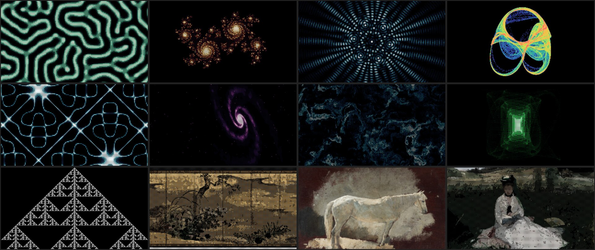

# Mosaïque

*High-density wallpaper generator: mathematical fields and public-domain paintings rendered as circle, square, pixel or ASCII mosaics, at your screen's exact resolution.*

Générateur de fonds d'écran haute densité : un champ mathématique (ou un tableau)
rendu en grille de cercles, de carrés, de pixels ou de caractères ASCII, à la
résolution exacte de l'écran.



```
source → champ 2D [0,1] → rendu → PNG à la résolution de l'écran
```

## Installer et lancer

Il faut Python 3 (aucune dépendance) et un navigateur récent.

```bash
git clone https://github.com/SimonKreis/mosaique.git
cd mosaique
./mosaique
```

Le script démarre un petit serveur local et ouvre `http://127.0.0.1:8765/`.
Pour l'ajouter au lanceur d'applications, crée
`~/.local/share/applications/mosaique.desktop` :

```ini
[Desktop Entry]
Name=Mosaïque
Exec=/chemin/vers/mosaique/mosaique
Icon=/chemin/vers/mosaique/web/icon.png
Type=Application
Categories=Graphics;
```

## Contrôles

| Contrôle | Effet |
|---|---|
| Source | une équation, « au hasard », un tableau du musée ou ton image (glisser-déposer) |
| Rendu | cercles / carrés / pixels / ASCII, ou hasard |
| Densité | taille de cellule, parmi les diviseurs du PGCD de la résolution (aucune cellule coupée) |
| Palette | 7 palettes sombres, couleurs de l'image, ou hasard |
| Écran | résolution cible (lue via `hyprctl`, sinon 3840×2160) |
| `espace` | shuffle : nouvelle seed ; les réglages fixés restent verrouillés |
| `←` `→` | historique |
| `K` | garder : enregistre le PNG |
| `A` | appliquer : enregistre le PNG et le met en fond d'écran (Omarchy) |

Changer le rendu, la densité ou la palette garde la même seed : on compare la même image.

### Où vont les images

1. `MOSAIQUE_KEEP_DIR` s'il est défini ;
2. sinon le dossier de fonds d'écran du thème [Omarchy](https://omarchy.org) actif
   (`~/.config/omarchy/backgrounds/<thème>/`) ;
3. sinon `~/Pictures/mosaique/`.

« Appliquer » passe par `omarchy theme bg set`. Sans Omarchy, utilise « Garder »
et ton outil de fond d'écran habituel.

## Champs

| Champ | Principe |
|---|---|
| Ondes | interférence de 2 à 6 sources circulaires amorties |
| Chladni | lignes nodales d'une plaque vibrante, un ou deux modes superposés |
| Turing | réaction-diffusion de Gray-Scott (labyrinthe, corail, mitose…) |
| Julia | ensembles de Julia, coloration par itération lissée |
| Attracteur | densité d'un attracteur de Clifford ou de de Jong |
| Automate | automates cellulaires élémentaires de Wolfram, pondérés par la densité locale |
| Harmonographe | courbes de pendules amortis à rapports de fréquences simples |
| Encre | bruit de Perlin à déformation de domaine |
| Spirale | galaxie à bras logarithmiques |

Chaque champ tire ses paramètres dans des plages choisies une fois pour toutes ;
un filtre qualité rejette les images presque vides, saturées ou uniformes.

Le rendu ASCII trie les symboles selon la surface d'encre qu'ils couvrent
réellement dans la police (JetBrains Mono).

## Tableaux

Le mode Tableau tire au hasard une peinture en format paysage dans
l'[Open Access du Cleveland Museum of Art](https://openaccess-api.clevelandart.org/)
(domaine public, CC0), en écartant les pages de manuscrits.

## Journal des préférences

Chaque « garder » et « appliquer » est noté dans `data/journal.jsonl` avec tous
ses paramètres, pour fixer plus tard des réglages par défaut à partir de ce
qu'on a vraiment gardé.

## Reproductibilité

L'URL contient la seed et les réglages (`#seed=…&source=…`) : la même URL
redonne la même image.

## Licence

MIT
